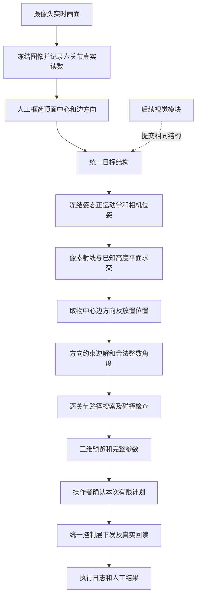

# 机械臂人工标注抓放系统实现与算法说明

更新日期：2026年10月24日  
对应版本：随臂冻结定位 `joint_snapshot_v1`，含旋转四角标注及ChArUco标定采集软件  
项目目录：`/Users/jarrite/school/mechanicalArm`  
设备目录：`/root/jjt`  
使用入口：[框选抓放页面](http://192.168.137.100:8080/manipulation?v=quad)

2026年10月24日新增：[相机标定页面](http://192.168.137.100:8080/calibration)已部署，支持原图角点识别、分开保存拟合与检查样本、内参计算、link4随臂手眼标定、明确采用和独立毫米位置检查。完整步骤见[相机标定使用说明](sorting_demo/相机标定使用说明.md)。软件与合成图识别验证通过；当前尚无本次实拍标定结果，不能将软件部署描述为已经完成实物标定。下文的110°视场、CAD相机位置与桌面高度数值描述尚未采用新标定时的默认来源；采用后由相应证据绑定的参数替换。

## 一 目前完成了什么

当前系统已经实现并部署了下面这条软件流程：操作者冻结机械臂摄像头画面，手工指定方块范围、顶面中心和方向；系统根据冻结时的真实关节读数及三维结构模型计算相机姿态，把图像点转换为底座坐标，计算取放所需的关节角度与运动顺序，检查路径，再由操作者确认后执行。

目标识别暂时由人完成。当前人工入口不调用颜色检测、目标检测或自动顶面识别。后续视觉模块可以提交同样的数据结构，复用定位、规划、确认、执行与记录功能。

**当前完成程度是“软件流程已实现、假设备测试通过、设备端已部署”。实际相机定位误差、真实夹持效果和连续抓放成功率尚未完成实机验收。** 网页能生成计划、模型看起来正确或舵机回读到位，都不能单独证明已经抓牢方块。

### 1.1 已实现的功能

| 内容 | 当前行为 | 验证状态 |
|---|---|---|
| 三维结构接入 | 六个STL与课程URDF装配，记录来源和SHA256 | 代码与模型文件已检查 |
| 随臂定位 | 每张冻结图使用当时的真实关节读数计算相机位姿 | 多姿态合成测试通过，真实精度待验证 |
| 人工目标输入 | 支持外围矩形、四角顶面轮廓、独立中心和边方向 | 前后端测试通过 |
| 旋转方块标注 | 四角允许旋转和透视，第一、二点明确指定边方向 | 合成定位及页面交互测试通过 |
| 放置目标 | 支持保存的底座平面坐标点，以及图中点击的桌面中心 | 软件流程已实现 |
| 只夹取模式 | 张开、接近、夹持、抬升，结束后保持夹持 | 假控制器流程通过 |
| 完整抓放模式 | 取物、抬升、转移、放置、松爪、撤离 | 合成规划及假控制器流程通过 |
| 运动预览 | 展示机械臂、桌面、方块、取放点、逐步参数与动画 | 页面及HTTP检查通过 |
| 执行控制 | 统一校验、硬件锁、确认令牌、版本绑定、去重、异常停止 | 假设备回归通过 |
| 结果记录 | 区分指令下发、真实回读和人工成功或失败 | 软件已实现，实机结果待积累 |
| 兼容旧功能 | 保留原手动调整、保存姿态、示教及 `pickup_only` | 原页面及相关测试回归通过 |

### 1.2 当前适用范围

首版处理单个、已知尺寸的30×30×30毫米方块。方块静止、平放、不堆叠；完整抓放的放置位置是同一桌面上的空区域。方块可以绕桌面法向旋转，但不是每个位置、每个方向都一定有合法机械臂路径。

新模式不要求回到固定观察姿态，也不要求事先把夹爪张开。它仍要求机械臂停稳、六关节读数完整、目标顶面可见、视线能与目标平面相交，而且起始夹爪空载。张开夹爪已经列入本次完整计划。

“从不同姿态计算”表示相机位姿随实际关节变化计算，不表示机械臂在运动中拍摄、夹着其他物体，或者处于碰撞状态时也可以直接开始任务。

## 二 相比原来手工标定位置的主要变化

原项目主要依靠事先示教或手工保存的角度。它适合重复到达已经记录的位置，但缺少从任意新图像位置计算空间坐标和关节目标的完整链路。

当前增加了三个环节：

1. **几何模型。** 用URDF中的关节轴、连杆关系和工具偏移描述机械臂，用STL描述外形及碰撞包络。
2. **图像到空间的计算。** 根据相机成像参数、当前相机安装姿态和已知平面高度，把人工点击的像素点投影到底座坐标。
3. **空间到动作的计算。** 用带夹爪方向约束的逆运动学生成关节目标，再搜索符合实际逐关节执行方式的路径。

因此，目标位置变化时不需要为每一个方块位置重新示教一组舵机角度。已有示教资料继续保留，作为独立功能和对照，未自动变成空间测量或验收证据。

## 三 系统结构与数据流



前端负责展示与点选，不直接连接舵机。后端负责可信冻结记录、定位、计划、版本检查和任务状态。设备控制层负责最终角度与时间校验和硬件写入。ROS2规划节点提供相同规划函数的纯计算服务，不直接控制舵机。

人工输入和未来视觉输入在“统一目标结构”处汇合。颜色识别等功能不需要侵入运动规划和硬件控制层。

## 四 三维模型的接入与参数提取

### 4.1 STL与URDF各自负责什么

六个STL分别对应 `base_link`、`link1` 到 `link5`，来自项目中的“三维结构文件”目录。STL提供三角网格外形；URDF提供关节原点、旋转轴、连杆连接和关节范围。单靠STL外观不能完整表达关节运动关系，因此两者配套使用。

模型坐标在运动学计算中使用米，配置与定位结果多数使用毫米；代码在接口处显式换算。STL源文件本身没有可靠的单位标签，当前结合课程URDF尺寸核对并按米解释网格，再转换成毫米处理。

`manifest.json` 保存源路径、网格边界、三角面数量和SHA256。读取模型时检查散列，避免资源变化后继续沿用旧几何参数。

### 4.2 相机安装与夹持中心

模型中的相机与支架属于 **link4**，夹爪属于 **link5**。因此，5号关节旋转夹爪时不能错误地把相机也随之旋转。

本地预处理脚本针对这份已核对结构，筛选link4上镜头圆柱所在的几何区域，以其前表面和边界中心形成相机安装候选。工具中心则取link5指端区域的几何中点。这是针对当前模型的几何提取规则，不是自动识别任意CAD零件的通用算法。

当前提取结果约为：

| 参数 | 数值 | 坐标与来源 |
|---|---|---|
| 相机位置候选 | `[-70.700, -48.100, -0.600] mm` | 相对link4，镜头前表面几何候选 |
| 夹持中心偏移 | `[0.062, -0.502, 100.981] mm` | 相对link5，指端区域中点 |
| 工具旋转偏移 | `[0, 0, 0]°` | 当前候选约定 |
| 夹爪闭合方向 | `[1, 0, 0]` | 工具坐标中的X轴 |

相机光学坐标到link4的候选旋转矩阵为：

```text
R_link4_camera =
    [ 0  0 -1 ]
    [ 0  1  0 ]
    [ 1  0  0 ]
```

这里的相机位置已经从模型取得，不再认为“模型看不出相机装在哪里”。仍需区分镜头前表面与有效光心，以及模型约定的图像轴与实际摄像头图像方向；这些不能仅凭壳体外形证明完全一致。

### 4.3 碰撞外形预处理

为避免每次规划遍历全部三角面，本地脚本对三角面按空间位置递归分组：选择三角面中心分布跨度最大的轴，按中位数分割，给每组完整三角形建立包围盒。包围盒边界向外取整，不通过缩小盒子来放行路径。

当前生成69个盒，分布为 `[4, 8, 8, 8, 8, 33]`，分别对应底座和五段连杆。link5额外增加覆盖60毫米最大开口的候选包络，避免把静态半开夹爪当作全部开合范围。

桌面检查另保留各网格凸包的支撑顶点，用于计算旋转后最低点。凸包由本地SciPy预处理生成；设备运行时只读取结果，不依赖SciPy重新计算。

这套包络覆盖模型中的结构和夹爪最大开口候选；线缆、现场新增附件、实际传动与柔性变形仍需要现场核对。

实现位置：[CAD预处理](sorting_demo/prepare_cad_profile.py)、[模型尺寸提取](sorting_demo/derive_manipulation_dimensions.py)、[模型资源清单](sorting_demo/models/manipulation/manifest.json)、[CAD参数](sorting_demo/models/manipulation/cad_profile.json)。

## 五 坐标系与正运动学

### 5.1 坐标系约定

系统使用底座坐标、各连杆坐标、工具坐标和相机光学坐标。底座Z轴向上；相机使用针孔模型约定，光学Z轴指向镜头前方。图像像素原点在左上角，u向右、v向下。

本文记 `T_B_C` 为“把相机坐标转换到底座坐标”的4×4齐次矩阵；类似地，`T_B_4` 表示link4到底座的变换。

对第i个关节，舵机读数与模型角度的关系是：

```text
theta_i = (q_i - zero_i) × sign_i × π / 180
```

其中 `q_i` 是舵机角度，`zero_i` 是模型零点，`sign_i` 为+1或−1。当前默认课程约定为五关节零点90°、方向+1；最终计算使用保存配置中的值。

正运动学按URDF顺序连乘：

```text
T_B_TCP(q) = T_origin1 R_axis1(theta1) ... T_origin5 R_axis5(theta5) T_5_TCP
```

旋转矩阵使用轴角形式的Rodrigues公式构造。工具偏移 `T_5_TCP` 使逆解约束的是夹持中心，而不是仅约束腕部连杆原点。

### 5.2 桌面高度如何取得

2026年10月24日用户提供[蓝圈侧面照片](sorting_demo/IMG_2710.heic)，并确认80毫米是从放置白色设备箱的灰色桌面量到圆形安装板上表面。对照base_link与link1网格，该大面积圆形上平面在模型中约为Z=80毫米。课程URDF的joint1原点Z=64毫米是另一内部基准；网格最高Z=82.8毫米含小面积螺钉凸起，不能作为被量表面的高度。

```text
灰色桌面Z ≈ 80 - 80 = 0 mm
30毫米方块放在该桌面时，顶面Z ≈ 0 + 30 = 30 mm
方块几何中心Z ≈ 0 + 15 = 15 mm
```

历史−16、14、−1毫米来自把64毫米关节原点误当作被量表面，不应继续作为本次桌面基准。上述新值依据照片对应和用户报告的80毫米测量，并不证明毫米级精度。若物体改放在设备箱上方黑色台面，必须另量该台面相对灰色桌面的高度，不能沿用Z=0。用户随后明确要求修改，设备已通过`/calibration/table-height`写入灰色桌面Z=0，记录`measured_model_datum`来源、模型/网格指纹与照片指纹；保留旧配置备份，已采用内参和随臂参数不变。此前3条Z=−80的检查记录保留为旧批次，参数变更后只供查阅，并已创建对应Z=0的新空检查批次；未将实测检查或抓取标记为通过，未执行实机运动。

### 5.3 随臂相机位姿

冻结时先读六关节，取一帧原相机图像，然后再次读六关节。两组读取结果不同则拒绝这次采样，要求停稳后重新冻结。这个检查用于发现采样期间的姿态变化，不是硬件同步触发或运动补偿。

每张冻结图保存原图、画面编号、分辨率、时间、真实读数和JPEG散列。相机姿态使用该图前五关节的原始读数：

```text
T_B_C(q_frozen) = T_B_4(q_frozen) × T_4_C
```

代码再取逆得到底座到相机的 `R, t`，满足：

```text
P_C = R P_B + t
```

客户端不能指定一组内部关节值来改变这张图的投影。服务端依据画面编号读取保存记录，覆盖请求中的 `_frame_joint_angles` 和 `_start_joint_angles`。

读取结果只作为投影证据及路径起点，不通过截断、加减或取模把读数变成运动目标。当前完整放置结束后撤离，不自动返回由原始读数拼出的姿态。

实现位置：[随臂相机变换](sorting_demo/cad_geometry.py)中的 `link_matrices`、`camera_extrinsics`，以及[冻结与目标业务](sorting_demo/manipulation_task.py)中的 `capture`、`evidence`、`target`。

## 六 相机成像参数与像素定位算法

### 6.1 当前内参如何取得

相机内参描述像素与成像射线的关系。相机安装位置属于外参；知道安装位置仍需要内参才能从像素求空间射线。

当前原装相机没有匹配到已验证的实际内参，默认按课程标称110°视场角作**对角视场估算**，同时假设方形像素、主点在图像中心、畸变为零。

对640×480图像，对角像素长度为800，估算焦距为：

```text
f = sqrt(640² + 480²) / (2 × tan(110° / 2))
  ≈ 280.083 px

K = [ 280.083    0      320 ]
    [    0    280.083   240 ]
    [    0       0       1 ]

distortion = [0, 0, 0, 0, 0]
```

代码也支持明确选择水平视场解释，或导入真实内参。导入参数须说明来源、保持与冻结图一致的分辨率，并提供3×3矩阵和5项畸变系数；不自动缩放、裁切或把其他畸变模型截成5项。

当前对角解释、零畸变和有效光心位置属于建模假设。更换相机参数可以改变空间定位结果，模型本身不能证明这些成像假设准确。

### 6.2 像素射线与平面求交

单目像素只能确定一条射线，不能独立确定物体深度。当前通过“方块已知高度且平放桌面”的约束解决深度问题。

首先用 `cv2.undistortPoints` 将像素转换为去畸变后的归一化坐标 `(x_n, y_n)`。在当前零畸变配置下，这一步按零畸变模型计算，并不表示真实镜头畸变已经测量。

```text
相机射线 d_C = [x_n, y_n, 1]^T
相机中心 O_B = -R^T t
底座射线 d_B = R^T d_C
```

对已知平面高度 `z_plane`，求交参数与交点：

```text
lambda = (z_plane - O_B,z) / d_B,z
P_B = O_B + lambda × d_B
```

射线接近平行于平面，或者 `lambda <= 0`、平面位于相机后方时拒绝定位。

取物中心和边方向端点投影到方块顶面，即 `z_plane = 14 mm`；图中放置点投影到桌面，即 `z_plane = -16 mm`。两个平面相差30毫米，不能混用同一个桌面映射来计算方块顶面。

当前四角轮廓用于明确顶面范围与输入合法性；没有用它做目标PnP、单应矩阵拟合或自动估计相机焦距，也没有把方框宽度直接换算成物体尺寸。

### 6.3 方块方向

人工指定同一条顶面边的两个端点，经顶面投影得到 `A`、`B`：

```text
d = B_xy - A_xy
yaw = atan2(d_y, d_x)
L_projected = ||d||
```

`yaw` 用于后续夹爪方向约束。正方形可使用相差90°的等价边方向，逆解会枚举这些对称方向。

### 6.4 边长不符提示的修复

旧实现把 `L_projected` 与30毫米比较；位置误差配置为1毫米时，只允许边长相差2毫米。由于当前相机参数仍是估算，代码可能把模型投影误差当成人工标注错误，阻止生成计划。

现在CAD分支将超差保存为定位诊断，并同时展示在计划摘要和最终执行确认中。真实标定分支仍保留边长一致性检查。像素端点距离至少2像素、方向投影不得退化等输入检查仍适用。

修复没有强制把投影边长缩放成30毫米，没有改变方块尺寸，也没有自动调整焦距或坐标。**诊断允许继续规划，不代表定位误差已经被消除。**

实现位置：[空间定位](sorting_demo/manipulation_geometry.py)中的 `camera_pose`、`project_to_plane`、`locate`。

## 七 人工标注与旋转顶面交互

### 7.1 从显示坐标还原原图坐标

网页可能缩放图像，鼠标坐标必须先还原为原始像素：

```text
u = (mouse_x - image_left) × original_width / display_width
v = (mouse_y - image_top)  × original_height / display_height
```

后端接收和保存的是原图坐标，不接收CSS显示尺寸下未经换算的点。

### 7.2 两种标注方式

**外围矩形方式：** 拖出能包住整个方块的矩形；单独点顶面中心，再点同一条顶面边的两个端点。矩形本身保持水平和竖直，方块可以斜放，不要求矩形边贴合方块边。

**四角顶面方式：** 从用于确定方向的一条边开始，沿顶面轮廓顺时针或逆时针依次点四角。第一、二点明确作为边方向端点，随后单独点顶面中心。系统生成兼容旧接口的外围 `bbox`，同时保存真正的 `outline_px` 四边形。

四角框既可以是旋转矩形，也可以是透视下的一般凸四边形。它不是要求在二维图中画出一个严格的正方形。

### 7.3 输入合法性

前后端共同检查图像范围、目标框大小、中心与边端点位置。四角还检查四点顺序、凸性和面积：轮廓不能交叉、重合或共线，面积至少4平方像素，中心与边方向点应在四角围成的顶面内。

前端使用相邻边叉积同号判断凸性，后端使用OpenCV凸轮廓与点到多边形检查。中心始终由人指定，不自动替换成矩形中心或四角均值。

支持撤销、重选和显示缩放。重新冻结或修改目标会撤销旧的本地确认，并请求后端使旧预览失效，不能拿修改前的令牌执行修改后的标注。

实现位置：[人工输入与交互](sorting_demo/manipulation_ui.js)中的 `imagePoint`、`outlineIssue`、`selectionIssue`、`targetInput`、`beginShape`。

## 八 带夹爪方向约束的逆运动学

### 8.1 五轴机构的约束

前五个关节决定机械臂及工具姿态，第六个关节控制夹爪开合。五轴机构不能实现任意六自由度末端姿态，因此规划器不承诺任意位置和方向都可达。

CAD模式按 `0°、15°、30°、45°` 依次枚举径向接近倾角。0°代表向下接近；倾斜候选朝目标所在的径向方向。只有整个取放计划通过检查，才接受该倾角；不是只检查抓取点。

### 8.2 位置与方向联合残差

逆解同时约束工具中心、工具接近轴和夹爪闭合轴的水平投影。对每个方块边方向，枚举 `yaw + 0°、90°、180°、270°`。

```text
e(q) = [ p_TCP(q) - p_target
         0.06 × (z_TCP(q) - approach)
         0.04 × (normalize(jaw_xy(q)) - desired_xy) ]
```

位置残差采用米；0.06和0.04是当前求解器的数值权重，用来平衡位置和方向，不是实测安全距离。

接近轴由径向单位向量和倾角构成，目标位于底座旋转轴上、径向方向退化时拒绝计算。夹爪轴水平投影退化时也拒绝。

### 8.3 解析种子与有界阻尼最小二乘

先根据课程五轴链的几何关系构造平面二连杆解析种子。对已扣除末端偏移的目标 `(y, z)` 和两段长度 `l1, l2`，肘关节候选来自：

```text
c = (y² + z² - l1² - l2²) / (2 l1 l2)
elbow = +acos(c) 或 -acos(c)
```

仅在 `c` 位于[-1,1]时构造解析根，同时枚举合法肩部、腕部与角度绕转候选。超范围的根直接丢弃，不截断成边界角度。当前姿态、腕部中间角和已配置的抓取参考姿态也可提供初始种子；空参考不参与。

然后进行有界阻尼最小二乘迭代：

```text
J[:, i] ≈ (e(q + 0.001° × unit_i) - e(q)) / 0.001°
delta_q = -J^T (J J^T + 10^-7 I)^-1 e
```

每个种子最多160次迭代。边界处向外的搜索变量被冻结，再对自由变量求解；步长按 `1、1/2、1/4、1/8、1/16、1/32` 回溯。只接受范围内且残差下降的更新。

这个过程是确定性数值求解，没有训练神经网络，没有通过学习数据拟合关节命令。

### 8.4 连续解转换为整数角度

舵机目标要求整数。求得连续解后，对每个角度分别取向下和向上的邻近整数，枚举组合；五轴单个连续候选最多32个整数格点。

每个整数候选重新做完整正运动学，检查：

- 硬边界、配置范围及URDF模型范围；
- 工具中心误差不超过配置阈值，当前为1毫米；
- 夹爪水平方向误差不超过配置阈值，当前为3°；
- 工具接近轴差的向量范数不超过0.035。

候选评分综合位置误差、方向误差和相对种子的关节变化量，代码形式为 `位置误差mm + 0.1×方向误差deg + 0.001×关节变化范数`，选较小者。评分用于选择候选，不表示最短路径或最优动力学控制。

1毫米阈值约束的是**候选在当前模型中的计算误差**，并不是相机到真实方块的总误差实测值。连续解越界或整数化误差超标时拒绝，不采用简单四舍五入后直接下发，也不把越界解裁成合法角度。

实现位置：[方向约束逆解](sorting_demo/manipulation_geometry.py)中的 `ManipulationRobot.ik_directed`。

## 九 抓放阶段与运动路径规划

### 9.1 完整计划的阶段

| 顺序 | 阶段 | 计算或动作 |
|---|---|---|
| 1 | 张开 | 6号关节到当前CAD任务张开目标10° |
| 2 | 到取物上方 | 取物XY，转移高度 |
| 3 | 接近抓取 | 取物XY，抓取高度 |
| 4 | 闭合夹持 | 6号关节到已有夹持目标，当前127° |
| 5 | 抬升 | 保持夹持，回到取物上方 |
| 6 | 转移 | 完整抓放才移动到放置点上方 |
| 7 | 下降放置 | 放置XY，抓取高度加释放间隙 |
| 8 | 松爪 | 张开夹爪 |
| 9 | 撤离 | 回到放置点上方 |

“只夹取并抬升”在第5阶段结束，保持夹持，不自动松爪。新随臂模式的完整抓放在撤离后结束，不返回固定观察姿态；旧固定观察分支仍保留其原有返回语义。

一个阶段可能拆为多条单关节指令，所以界面显示的实际步数会多于阶段数。为绕开模型碰撞而使用的中间姿态也列入本次计划，执行时不临时增加未显示的动作。完整计划最多200条有限指令。

夹爪目标没有按开口宽度作线性插值。用户提供的10°对应60毫米开口、170°接近完全闭合，说明开合方向和两端状态；当前带块夹持继续使用已有127°目标，不自动改成170°，也没有假定127°必然对应30毫米净宽。实际夹持效果仍需验证，原旧入口的夹爪配置不被CAD任务覆盖。

### 9.2 当前高度参数

2026年10月23日文档编写时，通过只读状态接口核对的当前配置如下。这些高度由模型候选生成，并非实测安全高度。

| 项目 | 当前值 | 算法来源 |
|---|---|---|
| 抓取中心离桌高度 | 22.5 mm | 方块高度的3/4 |
| 转移中心离桌高度 | 约72.050 mm | 抓取高度 + 方块高度 + 两倍扫掠余量 |
| 释放间隙 | 2 mm | 当前计划参数 |
| 抓取中心在底座中的Z | 6.5 mm | -16 + 22.5 |
| 转移中心在底座中的Z | 约56.050 mm | -16 + 72.050 |
| 放置时TCP的Z | 8.5 mm | -16 + 22.5 + 2 |

TCP高度不等于方块几何中心高度。系统在夹持后保存方块相对TCP的附着变换，后续用该变换计算方块实际包络，而不是简单把方块中心放在TCP上。

参数预检还根据方向容差估计方块在夹持方向上的最大投影宽度。对正方形边长 `s`、方向容差 `alpha`、张开净宽 `w` 和位置阈值 `epsilon`，要求：

```text
projected_width = s × (cos(alpha) + sin(alpha))
(w - projected_width) / 2 > 6 × epsilon
```

这为配置中的误差预算保留夹爪单侧余量；当前使用30毫米方块、60毫米开口、3°方向阈值和1毫米位置阈值。该条件通过仍不证明真实误差满足预算，因为相机与机械误差尚未实测。

### 9.3 按实际逐关节顺序搜索

当前控制层逐个关节写入并等待既定运动时间与停稳时间，不能假设多个关节同步直线运动。因此路径检查模拟实际单关节次序。

对一段起点到终点，CAD分支先以与扫掠相同的包络余量检查起点、终点；端点碰撞时直接拒绝，不再尝试路点或零点绕行。然后找出需要改变的关节，以位掩码表示哪些关节已经到达终点，使用深度优先搜索寻找可行顺序，失败后回退并记住已无解的状态。每条完整顺序都恰好改变这些关节各一次，不因深度优先而增加步骤；最多五个关节改变时，组合状态最多32个。每条搜索边是一段真实将要执行的单关节运动，仍检查完整扫掠。其他旧入口保留原广度优先策略。

每段单关节运动按不大于0.25°的间隔做几何检查，并采用基于整臂伸展上界与1.25°角度预算计算的保守余量。若直接顺序不可用，CAD分支尝试在合法端点间增加5°、2°、1°分辨率的整数路点，逐段重新搜索与检查；还可尝试经过URDF零点构造的中间姿态。

所有路点仍须通过目标校验和完整路径检查。零点不是天然安全姿态；这些插入仅用于连接已合法的端点，不用于通过插值、截断等方式把非法端点改成可执行目标。

该算法属于有限候选和离散关节顺序搜索，未接入RRT、PRM或MoveIt全局规划器。没有找到路径，不等于从数学上证明不存在其他路径；找到模型路径，也不等于现场所有未知障碍都已检查。

计划计算在独立的纯计算进程中运行，本地逆解与扫掠检查最多45秒；计算期间释放控制锁，状态页面可继续响应并显示当前阶段。启用ROS2时仍须完成两边计划一致性检查。计算前后核对代码、配置、冻结画面、选点版本和真实起始姿态，期间修改选点或姿态会使结果作废。超时只返回失败，不产生可执行令牌或自动重试。前端分别说明计算超时、状态查询超时和连接失败。

碰撞计算批量变换固定包围盒并批量执行分离轴测试，保留原包络、余量、接触判定及0.25°扫掠间隔。随机姿态等价性测试用于比较优化前后的判定，不替代实机验证。

当前采用的实拍内参、随臂标定及桌面高度直接参与像素到基座坐标的投影；独立位置检查点及其5毫米门槛是验收记录，不再反向拟合相机参数。页面展示所用标定结果编号与桌面Z，便于核对来源。

### 9.4 九点参考引导（2026-10-28）

当前CAD人工抓放在设备已有`reported_cards`九点时，先核对原照片、中心、保存姿态、顺序/用时和配置绑定，再将九点旧固定观察姿态下的像素中心，用当前已采用的内参、随臂标定和方块顶面高度换算到基座平面。此位置是模型换算值，未冒充九点实测XYZ，未重新拟合相机或TCP。原数据保持不变。

覆盖单元内提供角度插值参考，覆盖外选邻近示教点作为初值，不作盲目角度外推，也不把九点覆盖区作为机械臂工作边界。九点`above/grasp`只作为姿态参考；旧记录没有完整抬升放置示教，因此每个实际运动目标仍须重新求解。

新求解器使用课程链解析种子、少量数值修正和批量FK检查，保留原位置/方向阈值、整数目标及关节范围。不把原始89度读数截断为90度目标。接近倾角优先参考九点实际姿态，并保留多个合法分支；先排除端点碰撞，再检查原0.25度完整单关节扫掠及携带方块约束。后续阶段失败时，有限回退到其他候选，不把首个候选失败称作物理不可达。原无九点数据的入口仍走旧几何求解；已有九点资料失配时明确拒绝，不悄悄绕开来源校验。

完整抓放先以所有本次抓取候选的腕部/倾角组合预检放置点上方，若有限整数候选已不能满足原误差条件，提前返回具体阶段和枚举误差，避免先计算取物路径再重复失败。只有整体包含携带、放置、释放和撤离的有限计划通过时，才产生执行令牌。

九点来源快照随纯计算请求送往独立工作进程和ROS节点。九点模式下两份纯计算并行进行，返回后仍核对相同计划、参考版本和阶段来源；任一失败或结果不一致均不生成执行令牌，不重发。生成前后及执行前核对来源，九点或标定变化即作废；网页显示“已接入九点参考”及本次使用的参考位置。此改造没有宣称真实抓放验收或设备端完整计算稳定小于一秒。

逐关节扫掠的每个原采样点仍保留，按16点一组批量计算正运动学、桌面支撑、69盒宽阶段、15轴分离轴、携带物和障碍检查。接近浮点接触边界时回到原逐点实现复核，失败保留首个样本的原错误原因。该路径仅用于九点引导模式；完整计划与原逐点扫掠结果进行等价性测试。实现见 [manipulation_collision.py](sorting_demo/manipulation_collision.py)。

实现见 [manipulation_reference.py](sorting_demo/manipulation_reference.py)、[manipulation_ik.py](sorting_demo/manipulation_ik.py)、[manipulation_guided.py](sorting_demo/manipulation_guided.py)。

### 9.5 八毫米位置容差（2026-10-28 用户明确要求）

当前位置求解接受容差由1毫米改为8毫米，方向仍为3度，原关节硬边界、整数目标、运动用时和碰撞/连续扫掠要求不变。夹爪开口参数不变；位置误差是允许的最大偏移，不是标准差，因此按两侧开口余量直接核对最大偏移，取消无统计依据的六倍乘数。名义取放区域重叠仍拒绝，较近区域显示提示；不把最大允许误差当作两个已经发生的偏移去重复扩大取放区域。

较宽容差启用从合法九点参考姿态出发的有界修正、额外整数邻域和垂直搜索种子；最终仍逐项验证目标相对原请求的误差不超过8毫米，不截断非法角度。夹持中心还须位于方块高度内。搬运方向使用真正求得的抓取姿态，放置目标用已抓方块相对工具的变换补偿实际模型抓取偏移，并检查方块释放位置误差，防止只满足工具位置却放偏方块。

逆解容差不改变像素到物理坐标的投影。位置检查的绑定改为只绑定真实几何，并兼容旧1毫米配置下的绑定哈希；原三点5毫米验收与证书不改写，不把较宽求解容差写成实测精度。相机、桌面或模型几何变化仍使旧检查失效。页面显示本次模型逆解误差和8毫米允许值，CAD尺寸偏差的提示独立保留。

### 9.6 携带与释放方块

夹持完成时计算：

```text
T_TCP_block = inverse(T_B_TCP_grasp) × T_B_block_grasp
T_B_block(q) = T_B_TCP(q) × T_TCP_block
```

搬运时保持夹持后的腕部滚转关系，并补偿底座方位变化，尽量使方块只绕桌面法向转动。放置前检查方块竖直轴与桌面法向的一致性，无法满足当前平放容差时拒绝任务。

附着变换是“方块被理想刚性夹持”的模型。实际滑动、夹空、松脱或柔性接触没有由这个模型自动检测。

实现位置：[阶段计划与连接](sorting_demo/manipulation_geometry.py)中的 `build_plan`、`_build_plan`、`ManipulationRobot.transition`，以及[基础路径搜索](sorting_demo/auto_geometry.py)中的 `Robot.transition`。

## 十 碰撞检测与扫掠检查

### 10.1 OBB与分离轴定理

模型局部包围盒随连杆变换到空间后成为有向包围盒OBB。先用轴对齐范围做宽阶段排除，再使用分离轴定理SAT检查可能相交的盒。

两个三维盒使用两组各三个主轴，以及两组轴的九个叉积方向，最多15个有效分离轴。若任一轴上的中心投影间隔大于两盒投影半径及余量之和，就判为不相交；所有轴均未分离则判为相交。退化的零叉积轴跳过。

检查范围包括非相邻连杆、底座、摄像头与支架、夹爪最大开口候选、已登记障碍，以及搬运中的方块。相邻连杆的连接重叠按模型连接关系排除，不对未知结构自动作豁免。

### 10.2 桌面与运动空间

桌面最低点使用各连杆网格凸包顶点变换后的最低Z值，避免把一个大包围盒中的空隙误当成实体。夹爪最大开口候选另计。携带方块则使用其旋转盒的最低点和范围。

图像有效取放区域 `workspace_xy_mm` 与三维允许空间 `motion_bounds_mm` 分开配置。方块中心合法还不足够，必须为方块半对角线和误差预算保留边缘余量；连杆、工具和方块也须处于运动空间中。

当前候选工作区为XY各±550毫米，三维候选范围为各轴±550毫米，由模型伸展上界生成。**这个范围不是实测桌面边界，也不代表机械臂在整个范围内都能抓取。** 代码仍继续检查可达性与碰撞；现场桌边、线缆及未登记障碍不会仅凭此范围自动进入模型。

### 10.3 方块连续扫掠的桌面检查

对单个关节旋转，方块每个顶点的高度可写为：

```text
z(theta) = a cos(theta) + b sin(theta) + c
```

代码通过虚拟角度求出系数，检查实际角度区间两端及内部可能达到最小值的极值角，发现方块在采样点之间穿过桌面也会拒绝。求系数所用的虚拟角度只用于数学计算，不会发给舵机。

这项解析检查专门覆盖携带方块与桌面之间的连续高度。其他几何关系主要采用离散角度采样加保守余量，不能宣称已经完成任意真实场景下的精确连续碰撞证明。

实现位置：[CAD碰撞](sorting_demo/cad_geometry.py)中的 `collision`、`obb_overlap`，以及[方块扫掠](sorting_demo/auto_geometry.py)中的 `sweep_block_floor`。

## 十一 三维预览与ROS2的实际作用

三维预览使用项目自带JavaScript和WebGL，读取本地部署的STL与后端计划。它展示冻结时的模型姿态、TCP、桌面、方块、放置点和逐步运动，支持视角旋转、缩放及播放。

动画按计划关节目标插值显示，实际执行仍由后端的相同计划逐关节控制。动画没有动力学、摩擦、接触或夹持力仿真，因此不属于物理仿真验收。约63MB的外形网格可以按需加载；没有WebGL时仍可查看明确的关节参数。

ROS2节点 `jjt_auto_planner` 通过 `/jjt/auto_plan/request` 和 `/jjt/auto_plan/response` 交换JSON消息，调用相同的纯计算规划函数。服务启用ROS2规划时，比对本地和节点返回的动作、起点、时长、模型版本及空间目标。

这种比对用于发现进程或配置不一致，两个进程使用相同算法，不构成彼此独立的正确性证明。当前ROS2节点不直接写舵机，也不是MoveIt执行器。

实现位置：[WebGL预览](sorting_demo/manipulation_view.js)、[ROS2计算节点](sorting_demo/ros_planner.py)。

## 十二 执行确认与异常处理

### 12.1 从预览到执行

“冻结”“标注”“仅计算空间位置”“生成计划”和“播放预览”均不发送机械臂运动。操作者核对实际起始读数、取放位置、模型与成像来源，以及全部关节目标、时间和顺序后，点击“确认执行以上步骤”，才通过原 `/control/execute` 入口提交本次执行。

新模式不另要求固定观察姿态、预先张开、全局采用候选或五个位置的空载记录。空载逐步检查仍保留为可选功能，已有证据和真实验收状态不会因此伪造成通过。

本次确认绑定冻结目标、完整有限计划、规则、代码、模型资源和配置。执行前可重新计算同一冻结目标来核对计划一致性，但不再打开相机取新目标或重新识别方块。

### 12.2 统一目标边界

所有下发复用 `arm_playground/arm.py` 的 `angle`、`timing` 与 `Controller.write`。

| 项目 | 约束 |
|---|---|
| ID 1、2、3、4、6硬边界 | 0～180° |
| ID 5硬边界 | 90～270° |
| 实际目标范围 | 还必须满足保存配置中的更窄范围及模型范围 |
| 角度 | 整数，不接受布尔值、非法数值或小数目标 |
| 单次运动时间 | 500～10000毫秒，整数 |
| 停稳等待 | 100～5000毫秒，整数 |
| 同时硬件任务 | 最多一个 |
| 自动重试 | 零次 |

观察读数在已配置边缘允许1°容差，仅用于真实起点与几何观察。运动目标不得利用这项容差扩大范围，也不得把89°的原始读数静默改为90°后当作发送目标。

### 12.3 读取与停止条件

新人工完整任务要求完整真实读数。冻结时检查采样稳定性；预览时核对实际姿态相对冻结姿态没有超过1°差异；开始执行时原控制层再检查起始读数是否与预览记录一致。后者当前按有效读数变化拒绝，不自动用新姿态重算后继续。

每步下发后回读六关节，与累计预期目标比较，偏差超过1°则停止后续下发。读取失败、下发异常或版本变化同样停止，不自动重读、重试、回零或松爪。旧 `pickup_only` 的读取失败继续执行例外仍仅适用于旧入口，不扩展到新任务。

### 12.4 时效与去重

冻结画面有120秒时效，最终确认令牌也有120秒时效。超时要求重新生成所需资料。修改目标、配置或代码会使原计划不能继续执行。

执行令牌只接收一次。同令牌的重复请求返回已有任务状态，不重复下发。接收与完成记录写入日志；重启后已有任务不会因客户端补发而自动重跑，未确认完成的任务需要人工核对现场状态。

浏览器断线时暂停新的交互并查询任务状态，不把断线视作可以重新下发。网页取消或Ctrl+C不能保证撤回已经发给硬件的运动，不能称为硬件急停。

### 12.5 结果的三个层次

系统分别记录：指令已经发送、真实回读符合目标、操作者确认夹取或放置成功。回读角度到位只能证明关节读数符合检查条件；没有夹持传感器时，程序不能自动断言夹空、掉落或方块最终放置正确。

### 12.6 版本和验收统计方法

配置语义版本使用SHA256摘要，对数值等价的 `1.0` 和 `1` 作规范化，避免浏览器JSON序列化差异误使计划失效。文件审计另保存真实字节散列，检查规则、代码、资源、配置及冻结证据是否改变。保存设置使用 `expected_sha256` 检查并发修改，并保留原资料备份。

验收按当前配置版本、真实任务、固定点或像素点放置分别筛选，按开始时间排序。找到首段连续3次人工成功后，固定取紧随其后的10次作为统计序列；不是从全部尝试中挑出最好的10次。至少8次成功、10次记录齐全且结果可判定才通过。失败下发保留，未确认结果不能当作成功，模拟、只夹取和空载步骤不计入完整放置验收。

实现位置：[完整任务执行](sorting_demo/manipulation_task.py)、[原控制入口与去重](sorting_demo/control.py)、[统一硬件校验](arm_playground/arm.py)。

## 十三 未来视觉模块如何接入

人工与视觉目标共用以下结构。示例只说明字段关系，像素数值不是可直接执行的现场目标。

```json
{
  "source": "manual",
  "task_mode": "pick_place",
  "frame_id": "服务端返回的32位冻结画面编号",
  "image_size": [640, 480],
  "block_size_id": "block",
  "bbox": [120, 120, 240, 240],
  "outline_px": [[120, 160], [200, 120], [240, 200], [160, 240]],
  "center_px": [180, 180],
  "edge_px": [[120, 160], [200, 120]],
  "destination": {"kind": "pixel", "pixel": [450, 350]}
}
```

| 字段 | 含义与要求 |
|---|---|
| `source` | 人工为 `manual`，后续视觉为 `vision` |
| `task_mode` | `pickup` 或 `pick_place`；省略时兼容完整抓放 |
| `frame_id` | 必须关联服务端冻结记录，不能自行拼造有效证据 |
| `image_size` | 原图分辨率，必须匹配冻结图和相机参数 |
| `block_size_id` | 引用保存的物体尺寸版本，不从框大小推断尺寸 |
| `bbox` | `[left, top, right, bottom]`，仅表示有效目标范围 |
| `outline_px` | 可选，按轮廓顺序提供四角，旧矩形目标可以省略 |
| `center_px` | 顶面中心，不能默认使用整个物体轮廓质心 |
| `edge_px` | 同一条顶面边的两个端点，表示方向 |
| `destination` | 桌面像素点，或 `{"kind":"fixed","name":"保存点名称"}` |

`pickup`可以省略放置目标。四角模式下第一、二角作为人工选择的边端点；其他适配器仍明确提交 `edge_px`，不让后端从轴对齐框长宽猜方向。

视觉组后续只需在同一张冻结图上输出这些字段，继续走定位、预览和确认。不得把另一时刻、另一分辨率或裁剪后未还原的检测结果与当前冻结编号混合。内部关节字段由服务端填充，视觉模块不提交舵机命令。

### 13.1 主要HTTP接口

| 接口 | 用途 |
|---|---|
| `GET /manipulation/status` | 当前配置、准备状态、任务与模型资源 |
| `POST /manipulation/capture` | 冻结图像和真实读数，不运动 |
| `POST /manipulation/prepare-cad` | 根据冻结记录准备模型候选，不运动 |
| `POST /manipulation/target` | 空间定位，不运动 |
| `POST /manipulation/destination` | 将桌面像素转换为可保存的放置坐标 |
| `POST /manipulation/preview` | 生成完整正式预览或空载草案，不运动 |
| `POST /control/execute` | 确认后的唯一执行入口，携带本次令牌 |
| `POST /manipulation/invalidate` | 使待执行预览失效，不撤回已下发指令 |
| `POST /manipulation/step` | 可选空载下一步预览 |
| `POST /manipulation/validation` | 根据真实步骤回执登记空载证据 |
| `POST /manipulation/result` | 人工记录成功或失败 |
| `GET /manipulation/acceptance` | 当前版本的真实验收统计 |

POST沿用同源与CSRF检查。新配置独立保存在 `sorting_demo/manipulation_setup.json`，不覆盖旧示教资料。接口路由见[服务入口](sorting_demo/server.py)。

## 十四 保留的实测标定方法

按用户当前选择，日常使用不放十字纸，当前CAD流程也不要求先完成纸张标定。代码仍保留可选实测标定分支，用于以后提高或验证实际定位精度。

内参标定使用OpenCV `calibrateCamera`，输入10～30张真实、不同倾斜角度、相同分辨率的画面，以及至少四个非共线、已知相对位置的角点。重复画面不算多视角样本；检查RMS重投影误差不超过1像素，并要求平面法向变化足够。

外参使用已知底座坐标中的纸张点和图像点，通过 `solvePnP` 的迭代方法求解。再检查点位于相机前方、最大重投影误差不超过1像素。

这个实测分支的外参仍绑定已核对的观察条件；当前没有把它自动转换成覆盖任意关节姿态的实测手眼标定。随臂新模式使用的是前文所述模型安装变换。

独立验证使用未参与拟合的桌面点和方块顶面点，各至少三个分散且不共线的位置；模型核对使用多姿态真实TCP测量，并另留独立姿态。拟合成功、重投影误差小和独立物理定位达标是不同检查。

这些算法分支已经编写，但本项目当前没有完成对应的真实采样、独立误差验证和实机标定验收。当前 `model_reviewed=false`、`calibration_reviewed=false` 仍如实保留。

## 十五 测试与部署证据

### 15.1 最近一次回归

旋转标注修复后，`sorting_demo` 的166项Python测试通过，失败0、错误0。测试进程注入禁止构造真实 `Arm_Device` 的哨兵，使用假相机、假控制器和合成几何，不连接真实机械臂。

同时通过三组JavaScript测试：人工选点与缩放、完整页面流程、原页面回归；HTML标签配对与元素ID检查通过。此前随臂功能修改还单独通过51项 `arm_playground` 测试；这是此前同日记录，不描述为本次重新跑过的同一批测试。

测试覆盖多姿态投影、顶面与桌面高度区别、畸变参数、人工与视觉结构一致性、旋转及透视四角、无效轮廓、边长诊断、不自动缩放、整数化、不可达、携带物体、整批预检、读取或写入异常后无后续下发、令牌过期、版本变化、重复请求和重启去重等。

此前假HTTP端到端示例完成过13条模拟指令与13次匹配回读，重复请求不重发。该示例证明软件调用链可贯通，不能统计为13次实机抓取成功。

### 15.2 已知的规划拒绝案例

合成测试中，某一固定位置的45°旋转标注可以正确定位，但完整路径被不可达或桌面碰撞检查拒绝。同位置补充探查15°和30°也被拒绝。测试保留该事实，没有为了让这些方向通过而放宽碰撞检查。

因此当前能够确认“旋转标注与方向输入已支持”，不能确认“任意工作区位置和方向都能生成可执行路径”。后续要区分机构限制、候选搜索能力和真实模型误差，再决定是否改进规划器。

### 15.3 设备部署

最近一次更新包SHA256：

```text
438bb932e32c84b0bc404c4e89b18609ad529552e116c4d660a41a295659c1c4
```

更新前核对设备空闲及已有文件散列，备份到：

```text
/root/jjt/backups/manipulation_20261023T155011_318325Z
```

本次更新五个审阅文件，原配置、保存姿态及示教JSON散列保持不变。停止旧的空闲服务后，沿用原Python和ROS2环境重启，没有额外启动第二个相机或控制服务。

HTTP返回的HTML与JavaScript和本地文件逐字节一致；原生浏览器确认新按钮与提示可见，相机在线，服务为实机模式且空闲。`execution_ready=true` 表示当前软件规则允许生成并确认任务，不表示获得助手自行运动的授权，也不表示实际抓放已验收。

本次部署记录中的舵机读取数为0、运动指令数为0。本技术文档编写只做源码、日志和HTTP状态读取，没有触发冻结、规划执行或机械臂运动。

### 15.4 可追溯材料

| 材料 | 内容 |
|---|---|
| [最新修复报告](implementation_backups/rotated_annotation_20261023/REPORT.md) | 旋转标注、边长诊断、拒绝案例、部署结果 |
| [Python测试统计](implementation_backups/rotated_annotation_20261023/python_tests.json) | 166项回归结果与硬件禁止标记 |
| [Python原始测试日志](implementation_backups/rotated_annotation_20261023/python_tests.log) | 最近完整回归输出 |
| [设备部署报告](implementation_backups/rotated_annotation_20261023/device_deployment_report.json) | 备份位置、文件散列、原JSON保护记录 |
| [HTTP检查报告](implementation_backups/rotated_annotation_20261023/http_health_report.json) | 资源一致性、相机与控制状态 |
| [随臂功能报告](implementation_backups/dynamic_grasp_20261023/REPORT.md) | 动态起点、旧入口兼容、此前假HTTP及控制层测试 |

## 十六 当前操作步骤

1. 打开新版页面，选择“只夹取并抬升”或“夹取并放到指定位置”。确保机械臂停稳、起始夹爪空载、方块与桌面符合当前模型假设。
2. 点击“冻结画面”。不要求回到固定观察姿态；读取不完整或采样变化时先处理现场状态，不用假读数补齐。
3. 正放或斜放均可拖外围框；旋转或透视明显时用“四角框选”，从所选边的两端开始沿顶面轮廓点四角。
4. 单独点顶面中心。外围矩形方式还需点同一顶面边的两个端点；四角方式已使用首两角作为方向。
5. 完整抓放选择保存点，或在图中点击桌面空放置中心；只夹取模式不需要放置点。
6. 点击“生成计划”，检查定位诊断、模型来源、取放点、全部步骤、角度、时间及现场空间。
7. 操作者确认方块和放置区域未变化后，点击“确认执行以上步骤”。只有此时才提交运动。
8. 执行结束后观察真实结果，记录成功或失败。若异常，保留日志，核对现场后重新生成所需计划，不直接补发或自动重试。

冻结画面或确认令牌超时、机械臂移动、方块移动、相机安装或焦距变化时，旧计划不能继续当作当前现场计划使用。

## 十七 尚未完成的现场工作与方法边界

当前尚未完成独立位置测量、真实空载或带块路径验收、固定点及图中点选放置的规定连续试验。既定验收口径仍是两种放置方式分别先连续成功3次，再各记录连续10次、至少8次正确抓放，全部失败保留。新模式已解除这些记录作为整批执行前置门槛，但没有把未做的试验登记成通过。

主要待验证项包括相机真实内参与畸变、有效光心和图像方向、舵机零点与回差、工具几何中心与真实夹持区域的偏差、127°夹持30毫米方块的效果、模型空域与真实桌面和线缆的一致性，以及搬运中的稳定性。

当前不包含自动物体识别、在线目标跟踪、深度相机重建、未知物体尺寸估计、堆叠抓取、接触力控制、自动滑落检测和闭环视觉伺服。执行时依照冻结目标，不追踪已经移动的方块。

本系统采用的是针孔相机、射线平面求交、刚体正运动学、有界数值逆解、正方形对称方向枚举、离散路径搜索和几何碰撞检测的工程组合。当前工作成果主要是把这些方法接成可替换视觉输入、可预览、可确认、可追溯的完整抓放软件流程，没有据此宣称提出新的基础算法或已经证明实机成功率。

## 附录 主要模块索引

| 文件 | 主要职责或函数 |
|---|---|
| [manipulation.html](sorting_demo/manipulation.html) | 三步主界面与折叠的高级设置 |
| [manipulation_ui.js](sorting_demo/manipulation_ui.js) | 原图坐标、矩形与四角标注、失效处理、计划确认 |
| [manipulation_view.js](sorting_demo/manipulation_view.js) | WebGL网格、模型姿态、方块附着与计划动画 |
| [manipulation_task.py](sorting_demo/manipulation_task.py) | 冻结、证据、配置、预览、执行、人工结果与验收统计 |
| [manipulation_geometry.py](sorting_demo/manipulation_geometry.py) | 平面定位、方向逆解、完整任务计划及准备状态 |
| [cad_geometry.py](sorting_demo/cad_geometry.py) | 随臂相机、FOV内参估计、CAD候选与OBB碰撞 |
| [auto_geometry.py](sorting_demo/auto_geometry.py) | 共用URDF正运动学、关节顺序搜索和方块连续高度检查 |
| [prepare_cad_profile.py](sorting_demo/prepare_cad_profile.py) | 本地网格包络、相机与TCP候选、凸包支撑点预处理 |
| [control.py](sorting_demo/control.py) | 原有执行入口、硬件锁、版本审计和请求去重 |
| [arm.py](arm_playground/arm.py) | 统一角度、时间、观察读数校验及硬件写入 |
| [ros_planner.py](sorting_demo/ros_planner.py) | 不控制硬件的ROS2计算节点 |
| [server.py](sorting_demo/server.py) | HTTP路由、同源及CSRF检查 |
| [部署器](deployment/deploy_manipulation.py) | 空闲检查、文件核对、备份、更新与原服务重启 |

本文以2026年10月23日当前源码、设备只读配置与已保存测试报告为准。历史说明中固定观察、强制五位置空载及自动返回观察姿态等描述，不应替代本文对应的 `joint_snapshot_v1` 行为。
